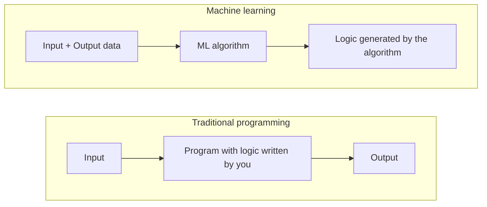

# Day 01: What is Machine Learning?

## 1. What this series covers?

One video every day for 100 days, going from the basics to the full flow of a machine learning project.

**What it is not:** an algorithms playlist. Algorithms already have their own playlists on the channel.

**What it is:** everything around the algorithms.

- The ML life cycle (also called the product life cycle)
- Imputation, preprocessing, analysis
- Model selection and feature selection
- Bias-variance trade-off
- Deployment

**Why this matters:** beginners usually think knowing algorithms is enough. It isn't. Knowing how to build an end-to-end project, with the whole flow, is what separates an ordinary ML engineer from a strong one.

**Who it's for:** beginners, and intermediate people who want to fill gaps. The goal is to get you to an intermediate level.

---

## 2. What is machine learning?

**Formal definition:** a field of computer science that uses statistical techniques to give computer systems the ability to "learn" from data, without being explicitly programmed.

**In simple words:** machine learning is learning from data.

The key phrase is **"without being explicitly programmed"**, so let's see what explicit programming means.

---

## 3. Explicit programming vs ML

**Explicit programming** means you write code for every situation yourself. You think of a case, then write a rule for it.

**Machine learning** works differently. You don't write the rules. You give the algorithm data containing both the **inputs** and the **correct outputs**, and the algorithm finds the pattern between them. Once it has found the pattern, you give it a new input and it produces the output.

| | Traditional programming | Machine learning |
|---|---|---|
| You provide | Input and the logic | Input and output (data) |
| You get | Output | The logic (the trained model) |
| Who writes the rules | You | The algorithm |
| When things change | You edit the code | The data changes, and so does the logic |

The good part: you don't have to write code for every case. The algorithm handles that.

### The addition example

- You write a program to add two numbers. It returns the sum for two numbers, but if you give it more than two, it fails, because it was explicitly coded for two.
- In ML, you give an Excel file where each row has some numbers and their sum. The model trains on it and realises the pattern is addition. After training, the video says you can give it two, four or ten numbers, and it adds all of them.

That's the key difference, and the reason ML is so powerful in industry.

*Note: In practice, a normal trained model expects a fixed number of inputs, so the "any number of numbers" part is more of an intuition than something a basic model does out of the box. The core idea, that the model learns the rule from examples, still holds.*

---

## 4. When should you use ML?

The video gives three situations where ML is more useful than traditional software development.

### 4.1 You can't write rules for everything (example: spam filter)

You want to build an email spam classifier. As a normal developer, you'd collect emails that are already marked spam or not spam, look for patterns (words like *discount*, *sale*, *awesome* repeated a lot, lots of pictures), and write a long if-else ladder.

The problem: say you write "if *huge* appears more than three times, mark as spam." Advertising companies find out and switch to *big* or *massive*, so your code no longer catches them. You change the logic, they change the words again. You have to keep changing the logic constantly.

In ML this doesn't happen. It learns from data, so if the data changes, the logic changes automatically. You write one algorithm and it handles everything.

### 4.2 You can't even imagine the number of cases (example: image classification)

Say you want to detect whether a dog is present in a picture. There are hundreds of breeds: large, small, different colours and features. Writing a case for every breed is impossible.

So we use the same technique humans use. From childhood we're shown "this is a dog, that is a cat" and our mind keeps tagging names to animals. It keeps learning from data. ML does the same.

### 4.3 Hidden patterns in data (data mining)

- **Data analysis:** finding patterns or hidden information by plotting graphs.
- Sometimes the information is too hidden to see in graphs. For example, just by looking at email content you can't tell which keywords make an email spam.
- **Data mining:** you apply an ML algorithm on the data, build a prediction model (like the spam classifier), and then check the patterns the model extracted (like "if *huge* occurs frequently, it's spam").

When you extract important hidden information from data this way, it's called data mining. ML is a very important tool for it.

---

## 5. A bit of history: why ML took off after 2010

The speaker compares ML to **Nawazuddin Siddiqui**. He played a tiny role in *Munna Bhai MBBS* and was around for a long time, but only became a star later when things like OTT platforms and content-driven films changed the industry.

ML is the same. The theory and maths have existed for 40 to 50 years, but ML only came into the limelight in the 2010s.

**Why it was held back:**

- ML needs a lot of data, and back then gathering and labelling data was tedious.
- Hardware was too weak to run algorithms on that much data.

**What changed after 2010:**

- **Data:** the internet and smartphones. Think about how much data you generate yourself from morning to night, then multiply by around 4 billion internet users. The data created from the beginning of mankind until 2015 was created again in 2016 alone.
- **Hardware:** we carry up to 12 GB of RAM and GPUs in our pockets through mobiles. Back then, even 128 MB of RAM was a big deal.

We now have good hardware, data and algorithms, and the growth is not stopping any time soon.

---

## 6. Jobs and salaries

The speaker's view is that current ML salaries won't stay the same forever. It's pure economics.

1. When Java came to the market, only a few people knew it, but companies needed it because competitors were using it.
2. Companies had to fight for the few available professionals, which pushed salaries up.
3. The same is happening with ML. Colleges mostly don't teach it yet, so companies find few students who know it and have to compete for them.
4. As salaries rise, more people learn it. Eventually most people will know ML, like Java today, and salaries normalise because companies have plenty of options.

The graph of any technology goes up first and then comes down. We are at the initial growing phase, so if you learn it properly now, you can still get the success ML is currently giving.
