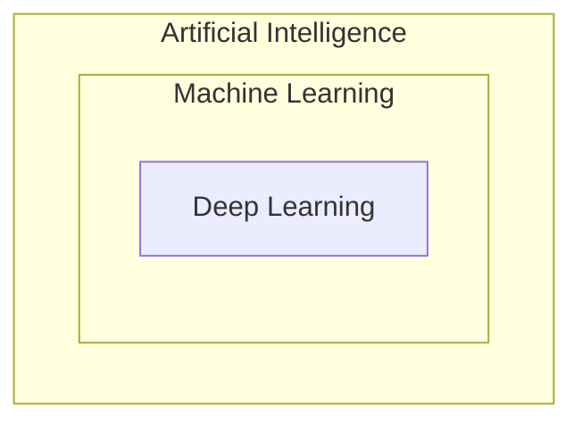

# Day 02: AI vs ML vs DL

## 1. The usual picture

If you google "AI vs ML vs DL", most results show three nested circles: AI is the outermost, ML sits inside it, and DL sits inside ML.

This is correct: ML is a subset of AI, and DL is a subset of ML. The rest of the video builds the intuition for why it's like this.

---

## 2. What is AI?

**Artificial Intelligence** means bringing intelligence into machines. The idea has been in people's heads for around 100 years: what if a machine could be as intelligent as us?

### Why AI today is mostly pattern recognition

Intelligence is not one thing. It's a mix of:

- Pattern recognition (what we use in daily life)
- Coding and solving puzzles (what IQ measures)
- Creativity and imagination
- Emotional intelligence

The AI we have today covers only a tiny part of this. The goal is a general intelligence that behaves like us, but that's very hard. So we are going down one specific path: **pattern recognition**.

The reason is that pattern recognition is measurable. We can't easily go after creativity, imagination or emotional intelligence, because we don't know what the correct results look like. We don't have an equation for love, and we don't know how to measure creativity. What can be quantified is pattern recognition, so almost everything you see in AI right now is related to it.

### A short history: symbolic AI and expert systems

- **1950s:** people like Alan Turing started thinking about whether intelligence could be added to machines, and the first intelligent systems began to appear.
- **Symbolic AI:** you build a huge knowledge system using if-else conditions, writing the logic for every condition.
- **Expert systems** came out of symbolic AI. Example: if you played chess against a computer as a kid, that was an expert system. An expert's knowledge was taken and converted into code, and you played against that code.

An expert system has two parts:

| Part | What it is |
|---|---|
| Knowledge base | Knowledge taken from a human expert |
| Inference engine | A program that makes decisions using that knowledge base |

In the **1980s**, everyone thought expert systems were the future of AI. AI and expert systems were basically synonyms.

### Why expert systems fell behind

- They work only on **very narrow, specific problems**, like playing chess or diagnosing a lung disease.
- They fail on **fuzzy logic** problems, where the logic is unclear. Example: detecting whether a picture has a dog. There are many breeds and every one has different features, so you can never write all the if-else conditions.
- Image classification, voice recognition and many other areas couldn't be handled with symbolic AI logic.

That's why expert systems fell behind, and machine learning came in to solve this.

---

## 3. What is ML?

**Recap of the definition (from Day 1):** a field of computer science that uses statistical techniques to find patterns in data. Simply, learning the patterns in data.

### The main difference from symbolic AI

In ML you never do **explicit programming** (rule-based programming), where you write logic for every case. Instead:

1. You have data with both inputs and outputs.
2. You feed it to the system.
3. The system's job is to find the rules, the mathematical patterns.
4. When a new input comes, it already knows the rules, so it can give the output (prediction).

### Why this is better than symbolic AI

Symbolic AI failed at fuzzy logic problems. Take dog classification: you can't write rules that identify every breed.

With ML you don't write the rules, the system generates them. You only provide the right data:

- Show the system lots of pictures of dogs of different breeds.
- Tell it "this has a dog, this doesn't, this has a dog, this doesn't."
- The system automatically tries to find the underlying representation in the data. That is **learning**: the pattern it's trying to recognise.
- With enough pictures, it can classify whether a given picture has a dog or not.

The core idea is small: why write the rules? Show it the data and it works out what is and isn't a dog.

This is how we learn too. As kids, we're shown "this is a dog, this is not." So ML is, in a way, inspired by our own evolutionary intelligence.

This small idea changed the whole industry. ML has been around for about 30 years (since the 90s), but it really took off in the last 10 to 15 years because of lots of data and good hardware.

### Is ML just statistics?

People used to say ML is nothing but statistics. Not exactly. It uses statistical and mathematical tools, but there isn't that much maths in it, and it's very practical and engineering-based. It is **inspired by statistics, not derived exactly from it.**

---

## 4. What is DL?

If ML can do everything well, why do we need deep learning? Two parts: what DL is, and why it's needed.

### What DL is

- DL is very recent. Work on it started earlier, but it only took off after **2012**.
- DL is a class of algorithms, and **first of all, it is ML.** It is not something separate.
- The process flow is the same as ML: give data, train the algorithm, reduce the error during training, the model gets trained, then give new data and predict.
- The only difference is the **algorithms** used. They are inspired by biology, specifically by the neuron.

**Careful with this:** DL is a mathematical model built on maths. Its core and smallest unit, the **neuron (perceptron)**, is based on the biological neuron, which is where the biological link comes from. But it doesn't mean DL works exactly like the brain. We still don't understand how our own brain works. Many people get confused here.

### Why DL is needed

There are things ML can't do, or can't do as well, and that's where DL shines.

**1. Automatic feature creation**

- In ML you have to provide the **features**, meaning you tell the system what the input should contain. For dog vs cat, you'd define things like: pointy ears means dog, whiskers means cat, a curled tail means dog.
- In DL, the system creates or identifies these features on its own.
- This is very useful for fuzzy logic problems where you don't actually know what features exist.

Example from the video: building a system that looks at a resume and decides whether the person will get placed.

- **With ML:** you must create the features yourself, and you can only do that if you know the data well. Someone from the training and placement cell would know things like: more than two certifications means a chance of placement, 90 to 95 percent means a chance, a backlog means no chance. Each of these is a separate feature.
- **With DL:** you just give the raw text and it creates the features itself.

This is one of the biggest differences. In ML, building features is a hard job, because you have to figure out which features will be the most accurate. In DL you don't have to worry about it.

**2. More layers give better results**

- As you add more layers of neurons, your classification, regression, or whatever task you're doing, keeps getting better.
- The reason: with each layer you go deeper into what's hidden in your data.
- Example, classifying a digit: the first layer picks out the edges, the second layer joins them into small parts, and the next layer combines those parts to say which digit it is.

**3. More data gives better performance**

- ML model accuracy improves as you add data, but only up to a point, then it flattens out.
- With DL, the more data you keep giving, the more the performance keeps improving.

Because of these reasons, DL is widely used in **image-related tasks** (like image classification) and **text-related tasks**, where it's much better than ML.

### If DL is so good, why use ML at all?

You don't use a sword where you need a needle. **DL is the sword:** powerful, but you don't use it everywhere.

| | Use |
|---|---|
| Big data | Deep learning, you get good results |
| Small data | Machine learning, it gives better results with less data |

About **90% of the world's data is small data.** Big data is mostly what Facebook, WhatsApp and similar companies deal with. It feels like everyone has lots of data, but in industry, banking companies, insurance companies and sports analytics companies usually don't have much. In those situations ML is still very effective today.

### ML vs DL at a glance

| | Machine learning | Deep learning |
|---|---|---|
| Features | You create them | Created automatically |
| Adding more data | Improves up to a point, then flattens | Keeps improving |
| Works best on | Small data | Big data |
| Good fit | Many classic problems, small datasets | Image and text tasks |

---

## 5. The full hierarchy

- **AI** is the biggest term, and everyone is chasing it.
- The most effective way to build AI right now is **ML**.
- Inside ML, a way to solve some very complex problems has emerged: **DL.**
- Both ML and DL are very popular today.
- Something completely new might come out in 10 years for building general AI, but right now, if you want to learn how to build AI, ML and DL are the right path.
